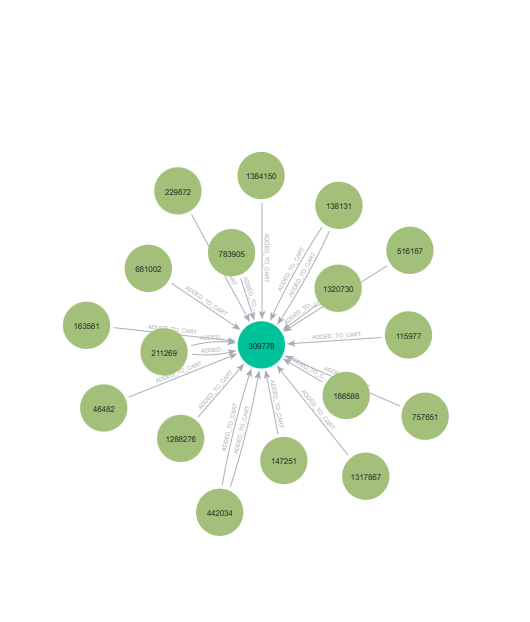
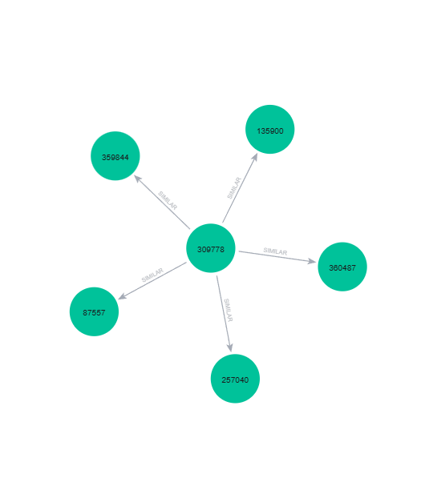

# UTS Graf Sains Data: Neo4j dan Sistem Rekomendasi (RetailRocket)

Proyek ini adalah pengerjaan **Ujian Tengah Semester Graf Sains Data** (Prodi S1 Sains Data, Universitas Negeri Surabaya, Gasal 2026/2027).
Data perilaku pengunjung toko online diubah menjadi **graf di Neo4j**, lalu dipakai untuk menghitung **kemiripan antar-item** dan
membuat **rekomendasi produk** dengan metode **KNN**.

- **Nama:** Muhammad Dafa Alvian Ramadhani
- **NIM:** 23031554017

## Gambaran Umum

Data dimodelkan sebagai graf bipartit:

- **Simpul:** `Visitor` (pengunjung) dan `Item` (produk)
- **Relasi:** `VIEWED` (melihat), `ADDED_TO_CART` (memasukkan ke keranjang), `BOUGHT` (membeli), dan `SIMILAR` (kemiripan antar-item)

Hasil analisis dipakai untuk menjawab dua bagian soal:

1. **Wrangling dan EDA:** filter periode waktu, impor ke Neo4j, komposisi graf, Vector Space Modelling (User dan Item),
   perbandingan proyeksi, dan similarity Jaccard antar-item.
2. **Analytics:** rekomendasi user-based KNN (k = 5) untuk user acak, dievaluasi dengan Hit@5 dan NDCG@5.

## Dataset

Dataset: **RetailRocket e-commerce events** (kolom `timestamp`, `visitorid`, `event`, `itemid`, `transactionid`).

- Unduh di Google Drive: https://drive.google.com/file/d/1pjBAX-E01HlSRWRxvI1e6nFPJeMycXKy/view?usp=sharing
- Letakkan file `events.csv` di folder `data/` sebelum menjalankan notebook.

Periode data yang dipakai:

| Fold | Periode |
|---|---|
| P1 (training) | 4 Mei 2015 - 4 Juli 2015 |
| P2 (testing) | 13 Juli 2015 - 28 Juli 2015 |

## Teknologi

Python, Neo4j (Cypher), `neo4j` (driver), `pandas`, `numpy`, `scipy`, `networkx`, `matplotlib`, `tqdm`.

## Struktur Repositori

```text
.
├── README.md
├── UTS_GSD_23031554017.ipynb      # notebook utama (kode, output, penjelasan)
├── data/
│   └── events.csv                 # dataset mentah (unduh dari Google Drive)
├── processed_data/                # hasil filter P1 dan P2 (dibuat oleh notebook)
│   ├── events_train.csv
│   └── events_test.csv
└── images/
    ├── graf_sebelum_similarity.png
    └── graf_sesudah_similarity.png
```

## Alur Pengerjaan

1. Koneksi Python ke Neo4j dan reset database.
2. Filter `events.csv` menjadi P1 (latih) dan P2 (uji), lalu simpan sebagai CSV.
3. Impor P1 ke Neo4j secara batch (5.000 baris per batch) dengan constraint unik pada `visitorid` dan `itemid`.
4. Query komposisi graf (jumlah simpul dan relasi) lewat Python.
5. Vector Space Modelling User dan Item, plot networkx, dan matriks sparse.
6. Perbandingan efektivitas proyeksi User vs Item.
7. Similarity Jaccard item-ke-item, hasilnya disimpan sebagai relasi `:SIMILAR`.
8. Visualisasi graf sebelum dan sesudah perhitungan similarity.
9. Pemilihan user acak (seed 42), rekomendasi KNN k = 5, dan evaluasi Hit@5 dan NDCG@5.

## Hasil Utama

| Besaran | Nilai |
|---|---|
| Data P1 / P2 | 1.250.321 baris / 356.242 baris |
| Simpul | 630.720 Visitor, 166.214 Item |
| Relasi | VIEWED 1.209.600; ADDED_TO_CART 30.484; BOUGHT 10.076 |
| Matriks VSM | 630.720 x 166.214; 963.730 elemen tidak nol; density 0,00091929% |
| Efisiensi proyeksi | Proyeksi Item 14,40x lebih hemat daripada proyeksi User |
| Item paling mirip dengan item 309778 | Item 257040 (Jaccard 0,1214) |
| User target KNN | Visitor 206353 |
| 3 item yang diiklankan | 256706, 366809, 28100 |
| Evaluasi | Hit@5 = 0 dan NDCG@5 = 0,0000 |

Catatan: evaluasi dilakukan pada satu user, sehingga nilainya bersifat biner dan tidak mewakili kualitas model secara umum.

### Graf sebelum dan sesudah perhitungan similarity

**Sebelum:** hanya ada relasi interaksi Visitor ke Item.



**Sesudah:** terbentuk relasi `:SIMILAR` antar-item beserta skor Jaccard.



## Cara Menjalankan

### Prasyarat

- Python 3.10 atau lebih baru
- Neo4j (Desktop atau server) yang berjalan di `neo4j://localhost:7687`. Notebook memakai sintaks `CALL (v, i, row) { ... }`,
  sehingga disarankan Neo4j 5.23 atau lebih baru.

### Langkah

1. Salin repositori dan masuk ke foldernya:
```bash
   git clone <URL-REPOSITORI-INI>
   cd <NAMA-FOLDER>
```
2. Buat environment dan pasang library:
```bash
   python -m venv myenv
   source myenv/bin/activate        # Windows: myenv\Scripts\activate
   pip install neo4j pandas numpy scipy networkx matplotlib tqdm jupyter
```
3. Unduh `events.csv` dari tautan dataset di atas, lalu letakkan di folder `data/`.
4. Nyalakan Neo4j dan pastikan koneksinya berhasil.
5. Buka notebook dan sesuaikan kredensial pada variabel `AUTH` dengan password Neo4j milikmu:
```bash
   jupyter notebook UTS_GSD_23031554017.ipynb
```
6. Jalankan seluruh sel secara berurutan (Restart Kernel lalu Run All).

> Perhatian: sel reset di awal notebook **menghapus seluruh isi database** Neo4j yang dipilih. Jangan jalankan pada database yang berisi data lain.

## Catatan Reproducibility

- User target dipilih dengan `np.random.seed(42)` dari daftar visitor yang diurutkan.
- Urutan hasil KNN memakai tie-breaker (`neighbor_id` dan `Recommended_Item`), sehingga hasilnya sama setiap dijalankan pada data yang sama.
- Posisi simpul pada gambar networkx menggunakan `spring_layout(seed=42)`.